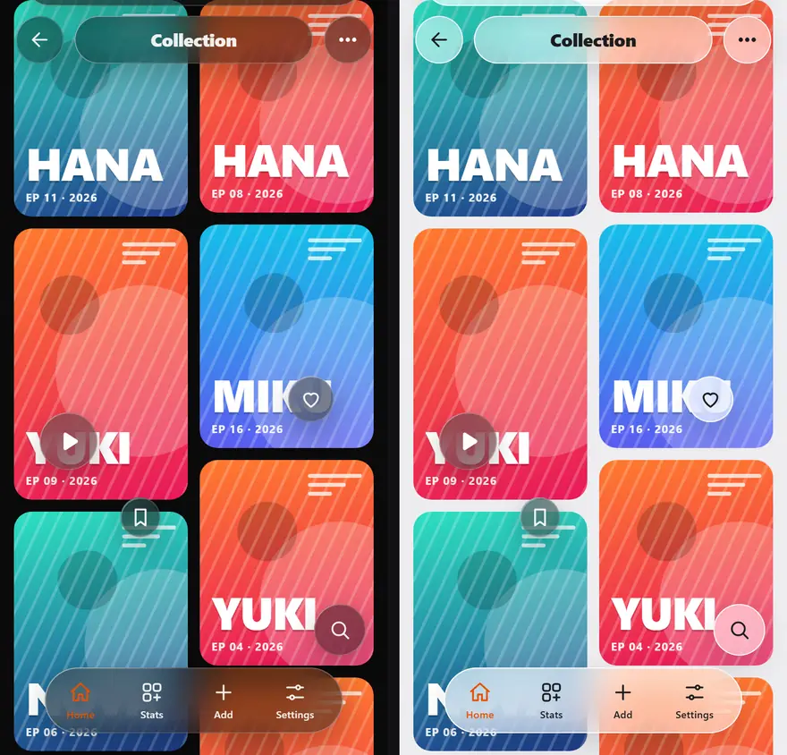
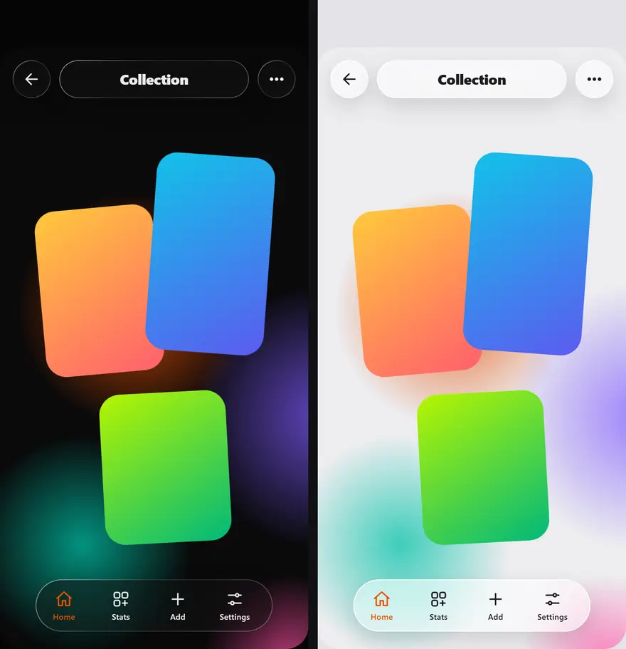
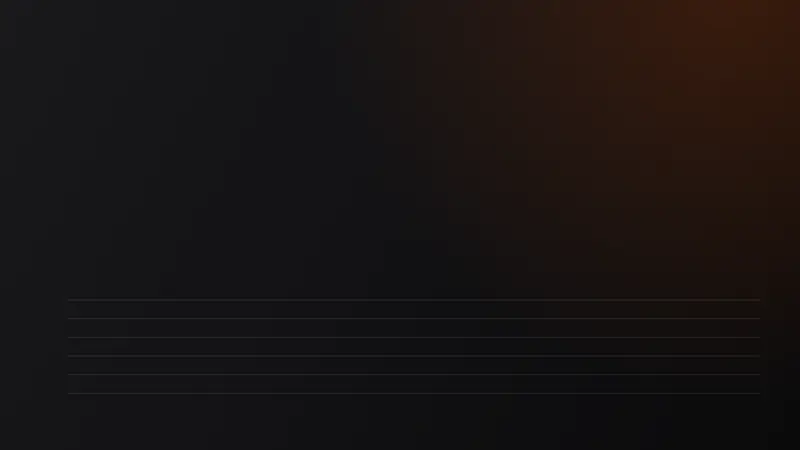

<div align="center">

# Vetro Modules

**Three solutions from the [Vetro](https://github.com/Phnem/Vetro) Android app, packaged as recipes you can lift into your own project.**

Frosted glass · A single table of springs · A chunked, resumable downloader

</div>

---

## What this is (and isn't)

These are **not libraries**. They depend on a particular UI stack, a navigation structure and a lot of taste, so a
Maven artifact would be either useless or a leaky abstraction. Instead every component ships as an archive with
exactly two files:

| File | For whom | What is inside |
| --- | --- | --- |
| `SKILL.md` | people who build with an AI coding agent | a detailed implementation prompt: exact numbers, hard rules, what to build, an acceptance checklist |
| `GUIDE.txt` | people who write the code by hand | the methodology, pinned versions, the full reference code, usage, tuning, troubleshooting |

Every number in both files comes from the shipping app. Nothing is "approximately like".

| Module | Archive | In one line |
| --- | --- | --- |
| [Frosted glass](#1-frosted-glass) | `frostedglass.zip` | 8-layer matte glass for Compose: blur, tint, grain, 1 px rim, highlight, shadow |
| [Motion](#2-motion) | `animation.zip` | one spring table + a window out of a dock icon, a "…" popover, a notification stack |
| [Chunked download](#3-chunked-download) | `download.zip` | multi-connection, resumable, verified downloads — 4.7× faster than one stream on the real release |

Download the archives from the **Releases** page of this repository.

---

## 1. Frosted glass

A matte, diffuse material (as opposed to "liquid" lens glass): it *diffuses* what is under it, so text on top stays
readable over moving covers. Eight layers in a fixed order — live backdrop → local blur → saturation/contrast →
neutral tint (after the blur) → micro-grain → one-physical-pixel rim → inner highlight → wide soft shadow — with
per-role material values for dark and light themes, and a deliberate fallback below Android 12.

<p align="center">
  
  <br><sub>dark · light — <a href="assets/video/frostedglass.mp4">full-quality MP4 (60 fps)</a></sub>
</p>

Shown: a dock capsule, round buttons, floating bubbles, a "…" dropdown panel and a notification plate over
scrolling colourful content. Inside the archive: the material table, the structural rules that prevent the glass
from collapsing into a flat fill, and the full `FrostedGlass.kt`.

Depends on `io.github.kyant0:backdrop:1.0.0` (check its licence) · Compose BOM 2025.12.00 · Kotlin 2.4.21 ·
blur needs Android 12+, below that a denser fallback material is used.

## 2. Motion

One table of `(ζ, T)` springs is the only source of truth; UI code never writes `spring(...)` by hand. The three
patterns are compositions of those tokens: a **window growing out of a dock icon** (`sharedBounds` +
`scaleToBounds`, separate enter/exit springs, content revealed after the shell has gained area), a **"…" popover**
(pop from the corner with a controlled overshoot, critically damped close), and a **notification stack**
(arrive / fling / reflow with a cascade that needs no timers).

<p align="center">
  
  <br><sub>dark · light — <a href="assets/video/animation.mp4">full-quality MP4 (60 fps)</a></sub>
</p>

The caption on top of the video names the token running at that moment. Inside the archive: the token table with
periods and stiffness, the conversion math, and the code of all three patterns.

## 3. Chunked download

Several connections pull 1 MB chunks from **one shared queue**, so a slow connection owns a chunk, not a share of the
file. Interrupted downloads resume from the first missing chunk, slow connections are replaced mid-chunk, expired
CDN links are re-resolved, a server that ignores `Range` falls back to a single stream, and the file gets its final
name only when size and SHA-256 match.

<p align="center">
  
  <br><sub><a href="assets/video/download_benchmark.mp4">full-quality MP4</a></sub>
</p>

Measured on the real v3.4.9-Stable APK (38.4 MB, GitHub CDN), 5 runs per method, methods interleaved, SHA-256
checked every run:

| Method | median | MB/s |
| --- | --- | --- |
| single stream | 47.3 s | 0.77 |
| 6 equal parts (classic split) | 9.8 s | 3.74 |
| **6 connections, chunk queue** | **10.2 s** | **3.61** |

~4.7× faster than one stream. The classic equal split is within noise of the chunk queue on this network — the
speed-up here comes from parallelism; the queue's value is resilience (resume, slow-connection replacement, no
stitching pass). Your network will differ: the harness is in [`tools/bench`](tools/bench), raw numbers in
[`results/download_benchmark_raw.json`](results/download_benchmark_raw.json).

Needs OkHttp 5.4.0 (HTTP/1.1 client — important) and kotlinx-coroutines 1.10.2. The portable version was run
against the real release: interrupted at 12 MB, resumed from 12 MB, verified, no leftovers.

---

## About the videos

They are **browser reproductions, not screen recordings of the Android app**: small HTML scenes in
[`tools/`](tools) that apply the exact material parameters (`FrostedMaterials`) and the exact spring constants
(`MotionTokens`, integrated numerically) and are rendered frame by frame with headless Chromium at 2× density.
The download graphic replays the measured byte timelines of the median runs. Treat them as a faithful illustration
of the numbers, not as a pixel-exact capture of Android's `RenderEffect`.

The inline previews are looping animated WebP (full colour, infinite loop; GitHub strips `autoplay`/`loop` from
`<video>` tags, so an MP4 would need a click). The MP4s next to them are the full-quality masters (H.264, CRF 16).
Every scene is a pure function of time and ends exactly where it starts, so it loops without a seam.

## Repository layout

```
frostedglass/   SKILL.md · GUIDE.txt
animation/      SKILL.md · GUIDE.txt
download/       SKILL.md · GUIDE.txt
assets/video/   *.webp (README previews) · *.mp4 (full quality)
results/        raw benchmark data
tools/          scenes, video renderer, benchmark harness, release packer
dist/           frostedglass.zip · animation.zip · download.zip   (generated; attached to each Release)
```

Rebuild everything:

```bash
# 1. capture lossless frames (60 fps, 2x density), one folder per theme
python tools/render_video.py capture tools/glass.html frames/glass_dark  --query theme=dark  --fps 60 --viewport 390x760 --scale 2
python tools/render_video.py capture tools/glass.html frames/glass_light --query theme=light --fps 60 --viewport 390x760 --scale 2
# 2. encode MP4 + looping WebP (dark | light side by side)
python tools/render_video.py encode assets/video/frostedglass frames/glass_dark frames/glass_light --fps 60 --webp-fps 20 --webp-width 880 --webp-quality 70
# 3. pack the three archives
python tools/build_release.py
```

Requires Python 3, `pip install playwright imageio-ffmpeg pillow` and `playwright install chromium`.

## Licence

GPL-3.0 — see [LICENSE](LICENSE). You may use, change and share these recipes and code under the terms of the GPL-3.0;
work you distribute that is derived from them must be GPL-3.0 too. If you ship the glass, also respect the licence
of the Kyant backdrop library it builds on.
